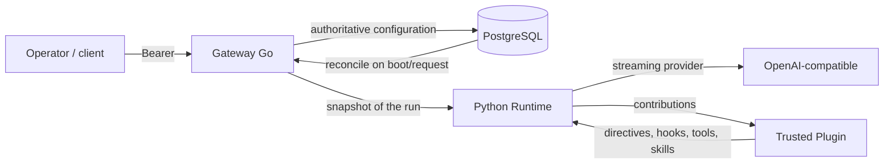
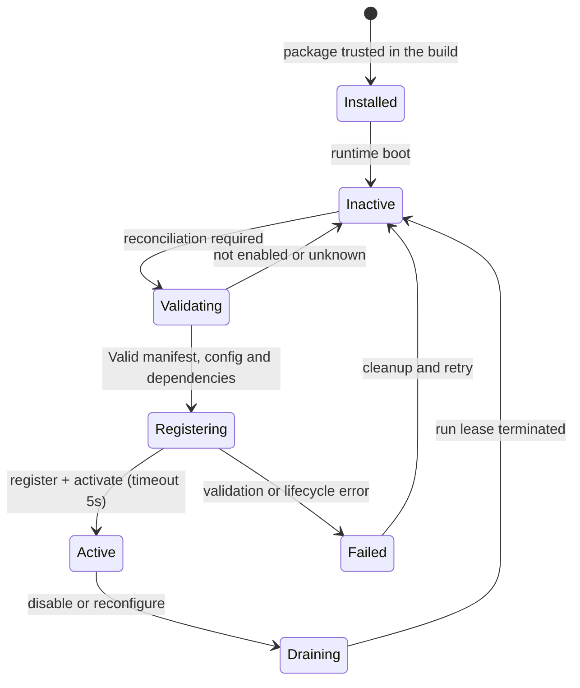
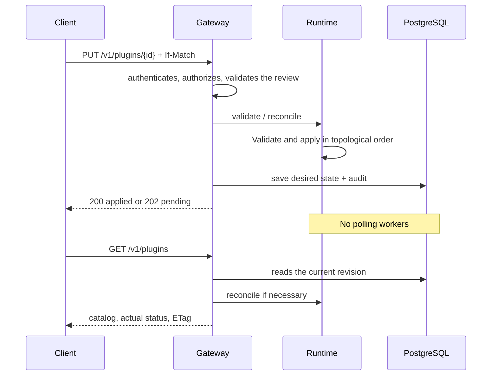
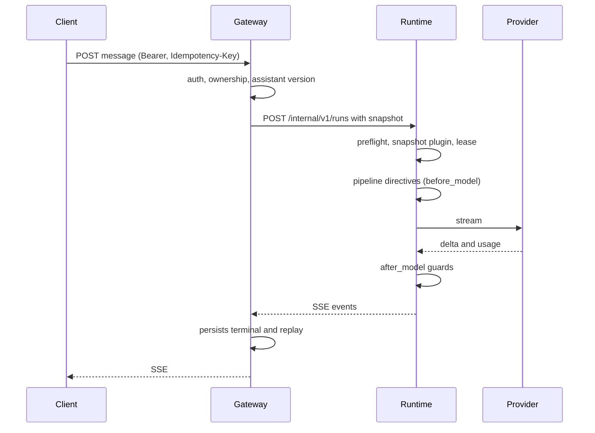

# Runtime lifecycle — plugins, directives and runs

Operational view of the life cycle introduced in Milestone 2. Contracts
details remain in [plugins.md](plugins.md), [plugin-sdk.md](plugin-sdk.md),
[directives.md](directives.md), [events-hooks.md](events-hooks.md) and
[tools.md](tools.md).

## Borders

- The gateway has authentication, ownership, assistant versions and status
  desired plugins.
- The runtime has AI execution, directive pipelines, hooks, tools and lifecycle
  of plugins.
- A plugin is trusted Python code already installed in the build. The API does not
  install, import, update or reload code.
- PostgreSQL is the authoritative source; the runtime only maintains the applied state
  in memory and rebuilds it from the desired configuration.

## Installation and activation

The `org.uai.hello` example package is included in the Docker build and
dev/CI dependencies. At boot it is inactive; activation occurs only after one
gateway reconciliation. Approving another package requires a
modification of the host list is a deploy, not an HTTP request.

Loading and activation apply, in order:

1. manifest with namespaced ID, versions/core and capabilities declared;
2. config validated by the host-approved Pydantic model, maximum 32 KiB;
3. namespace and capability of each contribution, maximum 64 contributions;
4. dependencies enabled and resolved in topological order;
5. atomic staging of contributions, without partial publication;
6. `activate(config)` with five second timeout;
7. publication of the active snapshot and existing leases.

An error in one step leaves the plugin `failed`, it does not publish partial contributions
and does not prevent independent runs from continuing. The cleanup of an activation
failed, removes contributions already registered; if the cleanup fails, the status
remains visible and may require a restart.

## Reconciliation and restart

- The review is global. PUT and DELETE require `If-Match`; without header yes
  receives 428, with obsolete revision 412. Same revisions with configurations
  several are rejected; the retry of the same configuration is idempotent.
- `200` with `applied=true` confirms the application; `202` with `applied=false`
  indicates configuration saved but application pending or failed. GET and the
  Subsequent requests attempt reconciliation again.
- After a runtime restart, the plugins restart inactive and are reactivated
  from gateway reconciliation. After a gateway restart, the
  configuration is read back from the database. There is no automatic recovery
  without a gateway request or boot.
- Any manual activation via the internal surface can be overwritten
  by public reconciliation, which remains authoritative.## Run, directives and leases

- Each run and each tool execution acquires a snapshot of the active contributions
  and a lease until completion, failure, or termination.
- Deactivating or reconfiguring an active plugin requires all leases to be
  finish. If the drain is not complete, the runtime rejects new runs with
  503 and the administrator tries again; runs already started are not cancelled.
- The order of directives is deterministic: dependencies, priority, name. Le
  mandatory core guards run after the middlewares and cannot be
  removed or deactivated from a plugin.
- A plugin can only transform the content of the template. Authority, principal,
  scopes, limits, operator prompts and authorized history remain unchanged; every
  reconstructed context is revalidated and an invalid outcome fails closed.
- Hooks receive metadata-only events and cannot modify authority,
  directives or outputs. Exception and content details are not propagated.

## Operational limits

- One gateway and one database runtime process supported. It's not a protocol
  for runtime replicas with distributed state.
- Database loss prevents reconciliation. A validation error
  after an upgrade it requires an administrative repair of the configuration.
- The general health of the runtime does not guarantee that every plugin is active:
  use plugin catalog and health.
- Drainage is cooperative. The runtime cannot terminate synchronous Python code
  blocker; a cleanup that doesn't return may require a restart.
- Lifecycle and health have a five second timeout. The system does not offer
  distributed atomicity between PostgreSQL and runtime.

## Verification matrix

| Criterion M2-10 | Evidence |
| --- | --- |
| Installing the trusted example | Docker builds; `tests/e2e/check_plugins.py`; `check_plugin_admin.py` |
| Activating and deactivating the directive | `tests/e2e/check_plugins.py`; `check_plugin_admin.py`; `apps/runtime/tests/test_plugins.py` |
| Hook without authority change | `apps/runtime/tests/test_hooks.py`; `tests/e2e/check_hooks.py` |
| Authentication and scope | `tests/e2e/check_auth.py`; `apps/gateway/auth_test.go`; `check_plugin_admin.py` |
| Lifecycle and failure isolation | `apps/runtime/tests/test_plugins.py`; `check_plugin_admin.py` |
| Order of directives | `apps/runtime/tests/test_directives.py` |
| Discovery and manifest | `apps/runtime/tests/test_plugin_manifest.py`; `test_plugins.py`; `check_plugins.py` |
| Config validation and negative cases | `apps/runtime/tests/test_plugin_manifest.py`; `test_plugins.py`; `check_plugin_admin.py` (422/412/428) |
| Full Gate | `make test`; `make e2e` |

`make e2e` starts isolated stack with PostgreSQL and mock provider, checks the
runtime in the container, public administration, SQL audit and restarts
separate runtime and gateway. The runner performs explicit image build
before startup.

The GitHub pipeline runs `make test` and `make e2e`; it was not done on GitHub
in this session. Local Docker/PostgreSQL tests are logged in
[progress.md](progress.md).